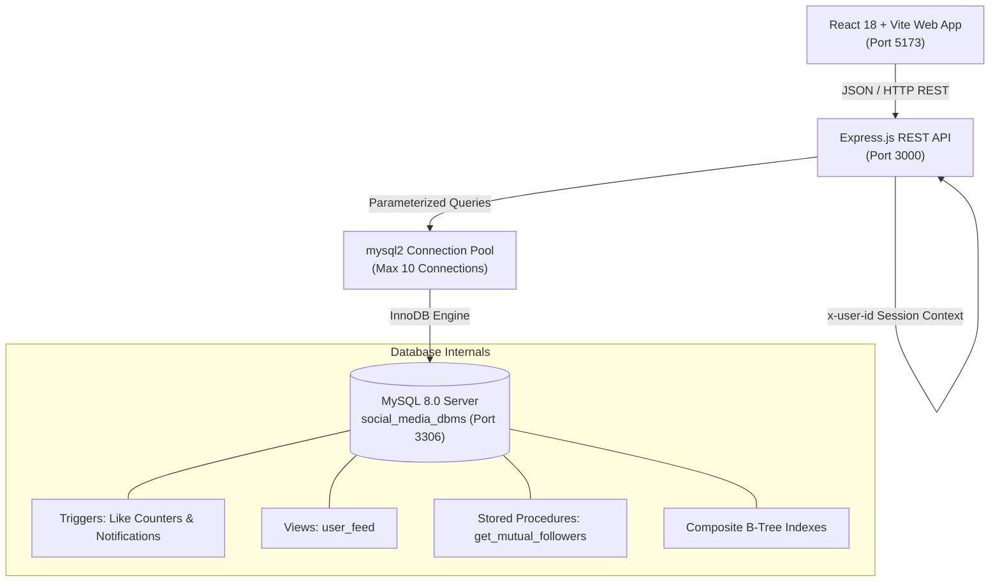
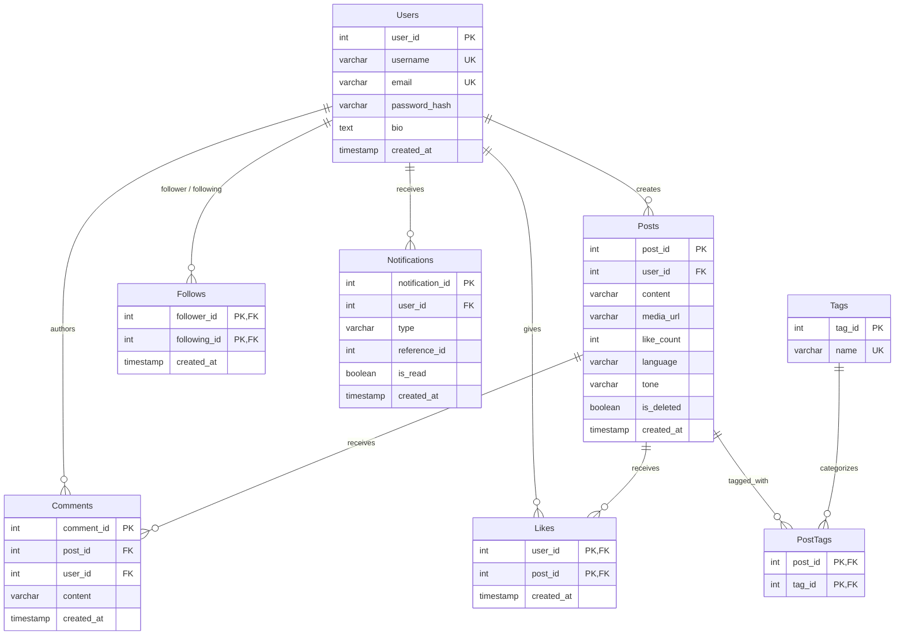

# ⚡ Kinetic Social — Relational DBMS Project

An enterprise-grade full-stack social media application and relational **Database Management System (DBMS)** implementation. Built with a normalized **3NF/BCNF** relational database schema, ACID transactional triggers, database views, stored procedures, multi-column B-Tree indexes, an **Express.js** REST API with connection pooling, and a modern **React 18 (Vite)** interface.

---

## 🌟 Key Highlights & DBMS Concepts

- **3NF Relational Schema**: 8 normalized tables with cascading foreign keys (`ON DELETE CASCADE`), primary key constraints, and unique constraints.
- **ACID Database Triggers**:
  - `trg_like_insert`: Automatically synchronizes `like_count` on `Posts` when a like is registered.
  - `trg_like_delete`: Decrements `like_count` upon like removal.
  - `trg_notify_on_like`: Automatically generates and routes unread alerts into the `Notifications` table.
- **Relational Views (`user_feed`)**: Encapsulates complex joins between `Follows`, `Posts`, and `Users` to present personalized chronological feeds with zero client-side join logic.
- **Stored Procedures (`get_mutual_followers`)**: Server-side relational procedure querying mutual followers between two users using self-joining set intersections.
- **Performance Indexing (B-Tree)**: Multi-column composite indexes eliminating table scans and filesorts on high-volume read paths (`idx_posts_user_created`, `idx_follows_following`, etc.).
- **Safe Full-Stack Security**: `bcrypt` password hashing (salt rounds = 10) and parameterized SQL queries preventing SQL injection vulnerabilities.

---

## 🏗️ System Architecture



---

## 📊 Entity-Relationship (ER) Model



---

## 🛠️ Tech Stack

| Layer | Technology | Details |
| :--- | :--- | :--- |
| **Database** | MySQL 8.0+ / MariaDB | InnoDB Storage Engine, `utf8mb4_unicode_ci` |
| **Backend API** | Node.js + Express.js | `mysql2/promise` connection pool, CORS, bcrypt, dotenv |
| **Frontend UI** | React 18, Vite | Lucide React, Glassmorphism CSS, Responsive Layout |
| **Runtimes** | Node.js v20+ / v24+ | Windows 10/11 Compatible |

---

## 🚀 Quick Start Guide (Windows)

### Prerequisites
1. **MySQL Server 8.0+** running as a Windows service (port `3306`).
2. **Node.js (v20+ or v24+)** installed.

---

### Step 1: Database Setup & Migration
Run the automated migration script. It automatically connects via TCP to your MySQL service, provisions the database, applies all schema tables, triggers, views, procedures, composite indexes, and seeds demo data:

Double-click **`setup_database.bat`** (or execute from terminal):
```cmd
setup_database.bat
```
*Prompt: Enter your MySQL `root` password when asked (special characters like `#` are handled automatically and safely quoted).*

---

### Step 2: Start the Application
You can start both backend and frontend concurrently with the master launcher:

Double-click **`run_project.bat`** (or `DBMS-main\start_all_windows.bat`):
```cmd
run_project.bat
```

This launches:
- **Backend API**: `http://localhost:3000`
- **Frontend Client**: `http://localhost:5173`

---

## 🌐 Open in Browser

Once both services are running, open:
👉 **[http://localhost:5173](http://localhost:5173)**

### 🔑 Demo Login Accounts
All pre-seeded demo accounts share the password: **`password123`**

| Username | Email | Bio / Persona |
| :--- | :--- | :--- |
| **`vansh_chadha`** | `vansh@kineticsocial.io` | Founder & Lead Engineer @ Kinetic Social |
| **`elena_rostova`** | `elena@vektorlab.io` | Lead Product Designer @ Vektor Lab |
| **`marcus_thorne`** | `marcus.thorne@cloudscale.net` | Senior Systems Architect (Rust & DB internals) |
| **`selah_kim`** | `selah.kim@gmail.com` | Design Technologist & Creative Coder |
| **`tarik_oconnor`** | `tarik@foundry.io` | Founding Engineer @ Foundry Systems |

> 💡 *You can log in using either the **username** or the **email** address, or click **Get Started** on the landing page to register a brand new user.*

---

## 📡 REST API Documentation

| Method | Endpoint | Description | Headers / Auth |
| :--- | :--- | :--- | :--- |
| `POST` | `/register` | Register a new user | Body: `{ username, email, password, bio }` |
| `POST` | `/login` | Authenticate user (by email or username) | Body: `{ email, password }` |
| `GET` | `/feed` | Personalized feed generated via `user_feed` view | `x-user-id: <user_id>` |
| `POST` | `/posts` | Create a new post with topic tags | `x-user-id: <user_id>`, Body: `{ content, tags }` |
| `POST` | `/posts/:id/like` | Like a post (triggers counter sync & notification) | `x-user-id: <user_id>` |
| `DELETE` | `/posts/:id/like` | Unlike a post (fires decrement trigger) | `x-user-id: <user_id>` |
| `POST` | `/users/:id/follow` | Follow a user | `x-user-id: <user_id>` |
| `DELETE`| `/users/:id/follow` | Unfollow a user | `x-user-id: <user_id>` |
| `GET` | `/users/:id/mutual-followers` | Executes `get_mutual_followers` procedure | `x-user-id: <user_id>` |
| `GET` | `/notifications` | Fetch unread notifications for current user | `x-user-id: <user_id>` |
| `PUT` | `/notifications/mark-read`| Mark user notifications as read | `x-user-id: <user_id>` |

---

## ⚡ Indexing & Performance Strategy

The database includes composite B-Tree indexes created in `database/indexes.sql`:

```sql
-- Feed generation optimization: eliminates filesort on post timeline
CREATE INDEX idx_posts_user_created ON Posts(user_id, created_at);

-- O(1) social graph lookup: who follows user X and feed joins
CREATE INDEX idx_follows_following ON Follows(following_id);

-- Rapid profile inspection: who does user X follow
CREATE INDEX idx_follows_follower ON Follows(follower_id);

-- Instant post engagement counting & liker extraction
CREATE INDEX idx_likes_post ON Likes(post_id);

-- Instant comment thread retrieval
CREATE INDEX idx_comments_post ON Comments(post_id);

-- Partial index scan for unread notifications inbox
CREATE INDEX idx_notifications_user_read ON Notifications(user_id, is_read);
```

---

## 📂 Project Structure

```plaintext
DBMS-main/
├── backend/                             # Express.js REST API & connection pooling
│   ├── server.js                        # API endpoints & route handlers
│   ├── db.js                            # mysql2 connection pool configuration
│   ├── package.json                     # Backend dependencies
│   └── .env                             # Database credentials & port configuration
├── frontend/                            # React 18 + Vite Web Application
│   ├── src/                             # React components (Feed, Login, Profile, etc.)
│   ├── index.html                       # Single-page application entry HTML
│   ├── package.json                     # Frontend dependencies & Vite configuration
│   └── vite.config.js                   # Vite bundler configuration
├── database/                            # MySQL Relational Schema & Ingestion
│   ├── schema.sql                       # 3NF DDL table definitions with constraints
│   ├── triggers_views_procedures.sql    # ACID triggers, user_feed view, procedures
│   ├── indexes.sql                      # B-Tree performance indexing rules
│   ├── seed_data.sql                    # Demo data for users, posts, follows, likes
│   ├── setup_db.js                      # Node.js automated database migration script
│   └── SocialMediaTop100.csv            # Dataset for creator ingestion
├── docs/                                # Documentation, Presentations & Diagrams
│   ├── reports/                         # Final project reports (PDF & DOCX)
│   ├── presentation/                    # Slide decks & LaTeX sources
│   ├── diagrams/                        # ER diagrams (Draw.io & PNG assets)
│   └── plan.txt                         # Detailed DBMS engineering specification
├── install_requirements.bat             # One-click requirements installer (Backend + Frontend)
├── run_project.bat                      # One-click master launcher (Windows)
├── setup_database.bat                   # One-click database initializer (Windows)
├── start_backend.bat                    # Standalone backend launcher
├── start_frontend.bat                   # Standalone frontend launcher
├── start_all.sh                         # Master launcher (Linux / Mac)
├── package.json                         # Root package manifest & multi-project scripts
├── requirements.txt                     # Python requirements for docs & report generation
├── .gitignore                           # Git ignore rules
└── README.md                            # Comprehensive project guide
```

---

## 🛡️ License

This project was developed as a comprehensive academic and engineering demonstration for **Database Management Systems (DBMS)**. Feel free to use, study, and extend it!
